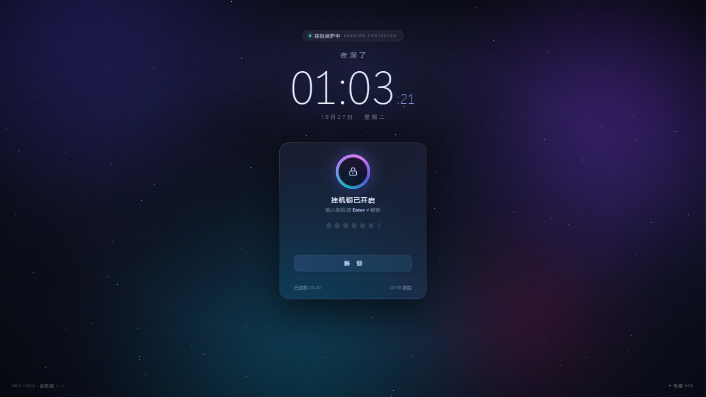

# 挂机锁 IdleLock

> 高颜值 Windows 挂机锁屏工具 —— 离开电脑时一键锁定,极光渐变 + 毛玻璃 + 星空粒子界面。



## ✨ 特性

- **一键锁定**:全屏置顶无边框窗口覆盖屏幕,底层键盘钩子拦截 `Win`、`Alt+Tab`、`Alt+Esc`、`Alt+F4`、`Ctrl+Esc`,鼠标被锁定在屏幕范围内
- **精美界面**:动态极光渐变背景、星空粒子、旋转光环、实时大时钟、毛玻璃卡片,鼠标静止 2.6 秒自动隐藏光标
- **密码解锁**:iOS 风格点阵输入,错误时红色光环 + 抖动提醒,连续错误 5 次触发 30 秒冷却
- **密码安全**:PBKDF2-HMAC-SHA256(20 万次迭代 + 随机盐)加密存储在本机,可选密码提示
- **输入法免疫**:锁定时自动禁用输入法(IME),中文输入法不会再拦截按键;检测到拦截时界面会给出提示
- **挂机信息**:实时显示已挂机时长、锁定时刻、电池电量与充电状态
- **空闲自动锁**:`--idle N` 模式下系统空闲 N 分钟后自动锁定(需保持进程常驻)
- **优雅退出**:解锁成功播放绿色对勾动画,瞬间恢复桌面

## 🆘 紧急退出

> **`Ctrl + Alt + F12`** —— 任何时候(包括输入失效、组件异常时)都能立即退出挂机锁。
> 该热键在系统键盘钩子层生效,不依赖窗口焦点,锁屏界面上也有常驻提示。

首次运行(设置密码之前)不会锁定键鼠,`Alt + F4` 可直接退出设置界面。

## 🚀 快速开始

```bat
:: 1. 安装依赖(仅一次)
pip install pywebview

:: 2. 双击 启动挂机锁.bat,或命令行运行
pythonw idle_lock.py
```

## 🔑 首次使用

首次运行会显示"创建解锁密码"界面:设置密码(至少 4 位,建议字母/数字/符号)、确认密码,可选填密码提示,点击 **开启保护** 即进入锁定状态。之后每次启动直接锁定。

**解锁**:输入密码后按 `Enter`(或点击"解锁"按钮)。忘记密码时,错误若干次后界面会显示你设置的提示语。若发现打字没有反应,先点击一下屏幕(恢复键盘焦点),并留意底部的输入法提示。

## 🛠 命令行用法

| 命令 | 说明 |
| --- | --- |
| `pythonw idle_lock.py` | 立即锁定 |
| `pythonw idle_lock.py --idle 30` | 进程常驻,系统空闲 30 分钟后自动锁定 |
| `pythonw idle_lock.py --preview` | 预览模式:窗口化,不锁定键鼠,仅供体验界面 |
| `pythonw idle_lock.py --selftest` | 环境自检(检测 WebView2 是否可用) |

双击 `启动挂机锁.bat` = 立即锁定;双击 `空闲自动锁定.bat` = 空闲 30 分钟后锁定(可用编辑器打开该 bat 修改分钟数)。

在浏览器中预览界面:先在 ui 目录运行 `python -m http.server 8642`,访问 `http://127.0.0.1:8642/index.html?demo`(演示密码 1234)。

## ❓ 忘记密码

删除配置文件后重新运行即可重新设置:

```
%APPDATA%\IdleLock\config.json
```

## 🔒 安全边界说明

本工具是**便捷型防误触/防偷看锁**,不是安全边界:

- `Ctrl+Alt+Del`、任务管理器属于系统层,任何用户态程序都无法拦截;紧急退出热键 `Ctrl+Alt+F12` 也是有意保留的出口
- 如需真正安全的锁定,请使用系统自带 `Win + L`
- 密码经 PBKDF2 加密存储,程序本身不联网、不上传任何数据

## 🧩 技术栈

- **Python 3 + pywebview 6**:全屏置顶无边框窗口,复用系统自带 WebView2(Edge)内核渲染
- **Win32 (ctypes)**:`WH_KEYBOARD_LL` 低级键盘钩子、`ClipCursor` 鼠标锁定、`GetLastInputInfo` 空闲检测、`GetSystemPowerStatus` 电池状态、`ImmAssociateContextEx` 输入法控制
- **原生 HTML/CSS/JS 界面**:极光渐变、canvas 星空、毛玻璃(背板模糊),零外部资源、完全离线
- **配置存储**:`%APPDATA%\IdleLock\config.json`

## 📁 项目结构

```
idle-lock/
├── idle_lock.py          # 主程序(锁定逻辑、键盘钩子、鼠标锁定、密码校验)
├── ui/index.html         # 界面(单文件,含全部样式与脚本)
├── 启动挂机锁.bat         # 双击立即锁定
├── 空闲自动锁定.bat        # 双击进入空闲自动锁定模式(默认 30 分钟)
└── preview.png           # 界面预览图
```

## 📝 更新记录

**v1.1**
- 新增紧急退出热键 `Ctrl+Alt+F12`(钩子层全局生效)
- 修复:首次运行设置界面阶段不再拦截 Alt+F4/Win/Alt+Tab,避免用户被自己锁死
- 修复:锁定时自动禁用输入法,中文 IME 不再吞掉按键;检测到拦截时给出提示
- 修复:程序组件(WebView2 桥)初始化慢时界面会明确提示并持续重试,不再误入演示模式
- 修复:键盘焦点丢失时显示"点击屏幕恢复输入"提示
- 修复:键盘钩子 64 位指针溢出异常(CallNextHookEx 参数类型)
